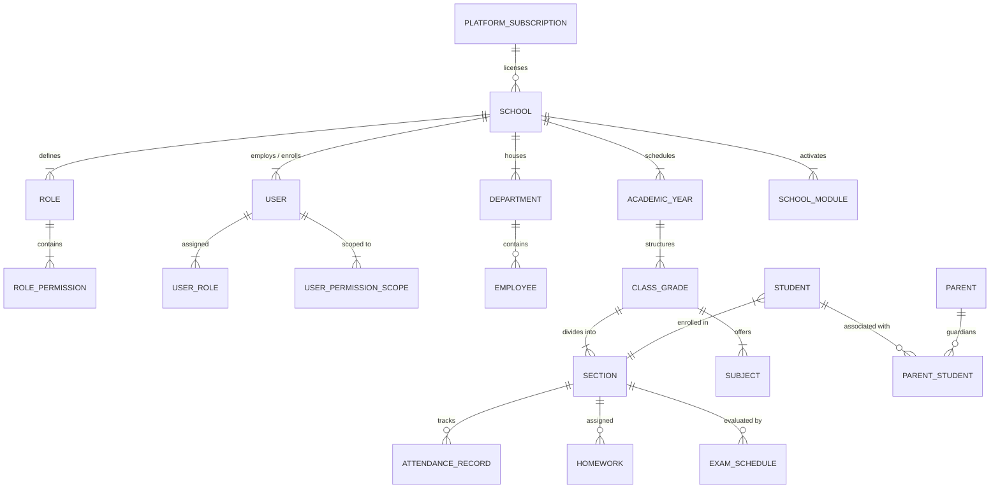

# NexEdu ERP - Database Architecture & Schema Specification
**Relational Data Model with Strict Multi-Tenant Partitioning**

---

## 1. Core Principles

1. **Strict Tenant Foreign Keys**: All tenant-scoped entities contain a mandatory `schoolId` foreign key referencing `schools(id)`.
2. **Composite Uniqueness**: Business identifiers are unique per school (e.g., `UNIQUE(schoolId, admissionNumber)`, `UNIQUE(schoolId, employeeCode)`, `UNIQUE(schoolId, code)`).
3. **Soft Deletion & Auditability**: Crucial records maintain `deletedAt` for soft-deletion and non-repudiation, alongside full audit log records.
4. **Flexible Metadata**: Schemas include JSONB / Text fields (`metadata`, `settings`, `customFields`) for Frappe/Odoo-like extensible attributes without breaking table migrations.

---

## 2. Entity-Relationship Overview



---

## 3. Schema Definitions

### 3.1 Multi-Tenancy & Platform Administration
- **`PlatformPlan`**: Subscription plans (`tier`, `monthlyPrice`, `maxStudents`, `maxTeachers`, `maxStorageGb`, `enabledModules`).
- **`School`**: Institutional tenants (`id`, `name`, `code`, `slug`, `domain`, `status`, `branding` [logo, primaryColor, accentColor, reportCardHeader], `address`, `phone`, `email`, `planId`, `activeYearId`).
- **`SchoolModule`**: Per-school feature flag switches (`schoolId`, `moduleKey`, `isEnabled`, `settings`).

### 3.2 Identity, Roles & Dynamic Permissions
- **`User`**: Normalized identity (`id`, `schoolId` [null for Super Admin], `email`, `passwordHash`, `firstName`, `lastName`, `phone`, `avatarUrl`, `status`, `isSuperAdmin`, `twoFactorEnabled`, `lastLoginAt`).
- **`Role`**: Custom role builder (`id`, `schoolId`, `name`, `code`, `description`, `isSystem`, `departmentId`).
- **`Permission`**: Global capability catalog (`id`, `moduleKey`, `action`, `description`).
- **`RolePermission`**: Permission mapping matrix (`roleId`, `permissionId`, `granted`).
- **`UserRole`**: Role assignments (`userId`, `roleId`).
- **`UserPermissionScope`**: Granular ABAC restrictions (`userId`, `classId`, `sectionId`, `subjectId`, `departmentId`). *Example: Restrict Teacher A to Class 8, Section B, Mathematics.*

### 3.3 Academics & People
- **`Department`**: Academic and administrative departments (`id`, `schoolId`, `name`, `code`, `hodId`, `status`).
- **`Employee` / `Teacher`**: Staff records (`id`, `userId`, `schoolId`, `employeeCode`, `designation`, `departmentId`, `joiningDate`, `qualification`, `salaryStructureId`).
- **`AcademicYear`**: Terms and sessions (`id`, `schoolId`, `name`, `startDate`, `endDate`, `isCurrent`).
- **`ClassGrade`**: Classes/grades (`id`, `schoolId`, `academicYearId`, `name`, `numericLevel`).
- **`Section`**: Class sections (`id`, `schoolId`, `classId`, `name`, `roomNumber`, `classTeacherId`).
- **`Subject`**: Subjects taught (`id`, `schoolId`, `name`, `code`, `type` [Theory/Lab/Elective]).
- **`ClassSubject`**: Linking classes and subjects with designated teachers (`classId`, `sectionId`, `subjectId`, `teacherId`).
- **`Student`**: Student profile (`id`, `userId`, `schoolId`, `admissionNumber`, `rollNumber`, `classId`, `sectionId`, `academicYearId`, `dob`, `gender`, `bloodGroup`, `status`).
- **`Parent`**: Parent/Guardian profile (`id`, `userId`, `schoolId`, `occupation`, `relation`).
- **`ParentStudent`**: Parent to student multi-child mapping (`parentId`, `studentId`, `isPrimaryContact`).

### 3.4 Operational & Academic Workflows
- **`Attendance`**: Daily/Period student attendance (`id`, `schoolId`, `studentId`, `sectionId`, `date`, `status` [PRESENT, ABSENT, LATE, HALF_DAY, EXCUSED], `remarks`, `markedById`).
- **`StaffAttendance`**: Staff biometric/manual attendance (`id`, `schoolId`, `employeeId`, `date`, `status`, `checkIn`, `checkOut`).
- **`Homework` / `Assignment`**: Assignments with attachments and deadlines (`id`, `schoolId`, `sectionId`, `subjectId`, `teacherId`, `title`, `description`, `attachments`, `dueDate`, `maxMarks`, `status`).
- **`AssignmentSubmission`**: Submissions & grading (`id`, `assignmentId`, `studentId`, `submittedAt`, `attachments`, `marksAwarded`, `feedback`, `status`).
- **`Exam`**: Examination terms (`id`, `schoolId`, `academicYearId`, `name`, `type` [UNIT_TEST, MID_TERM, FINAL, INTERNAL], `startDate`, `endDate`).
- **`ExamSchedule`**: Subject exam papers (`id`, `examId`, `subjectId`, `classId`, `date`, `maxMarks`, `passingMarks`).
- **`Mark`**: Student scores (`id`, `examScheduleId`, `studentId`, `marksObtained`, `grade`, `remarks`).
- **`FeeStructure`**: Fee categories & templates (`id`, `schoolId`, `classId`, `name`, `amount`, `frequency`, `dueDate`).
- **`Invoice`**: Student fee bills (`id`, `schoolId`, `studentId`, `invoiceNumber`, `totalAmount`, `paidAmount`, `balance`, `status`, `dueDate`).
- **`Payment`**: Payment receipts (`id`, `schoolId`, `invoiceId`, `amount`, `paymentMethod`, `transactionRef`, `status`, `receiptNumber`).
- **`LeaveApplication`**: Multi-level leave requests (`id`, `schoolId`, `employeeId`, `leaveType`, `startDate`, `endDate`, `status` [PENDING, APPROVED, REJECTED], `workflowStep`, `approvedById`).
- **`AuditLog`**: Tamper-evident ledger (`id`, `schoolId`, `actorId`, `action`, `resource`, `resourceId`, `oldValue`, `newValue`, `ipAddress`, `createdAt`).

---

## 4. Performance & Indexing Strategy

1. **Compound Multi-Tenant Indexes**:
   ```sql
   CREATE INDEX idx_student_school_section ON students(school_id, section_id);
   CREATE INDEX idx_attendance_school_date ON attendance(school_id, date);
   CREATE INDEX idx_marks_student_exam ON marks(student_id, exam_schedule_id);
   CREATE INDEX idx_audit_school_created ON audit_logs(school_id, created_at DESC);
   ```
2. **Foreign Key Cascades**:
   - Hard cascading enabled only for dependent detail rows (e.g. `RolePermission` on `Role` deletion).
   - Core operational data (Students, Invoices, Marks) use `RESTRICT` to prevent accidental institutional data destruction.
